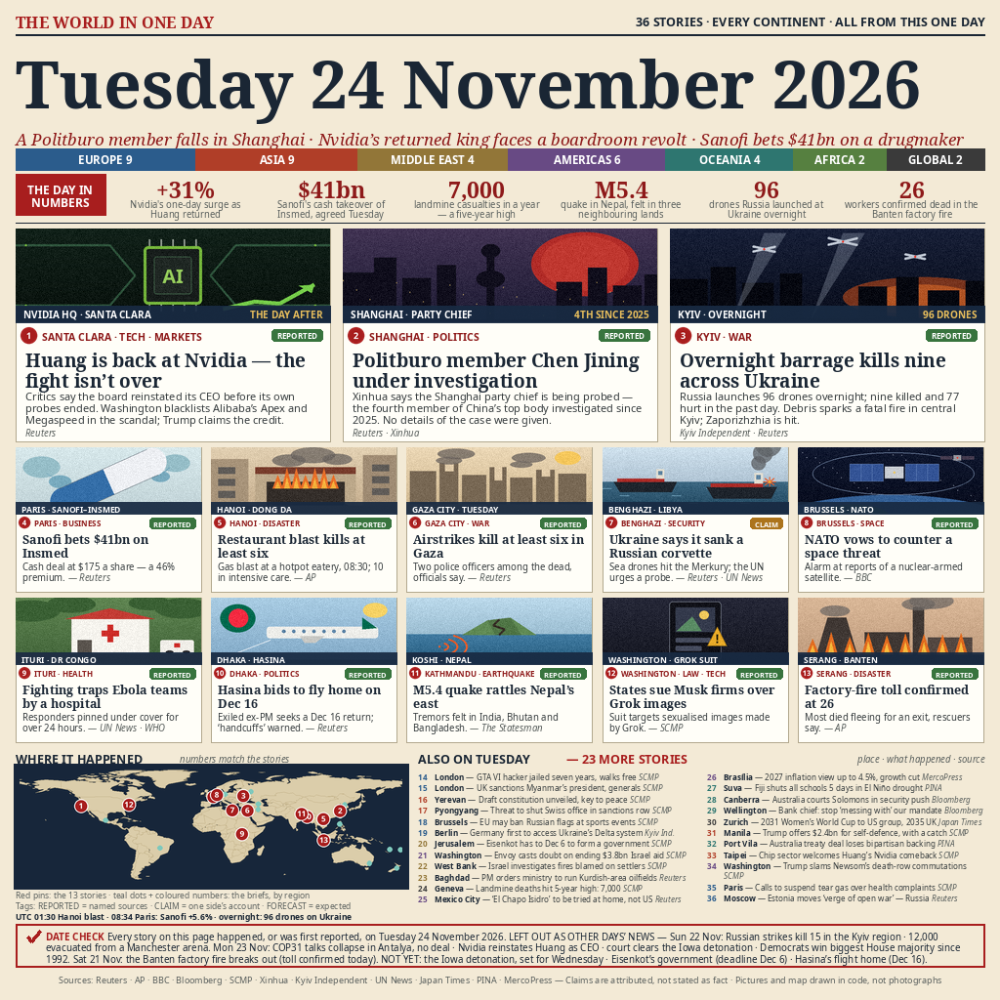

# 24 November 2026 — The World in One Day

One 1024×1024 newspaper front page that sums up a single day of world
news — **Tuesday 24 November 2026** — in **36 stories**: a masthead and
standfirst, a region tally (Europe 9 · Asia 9 · Americas 6 ·
Middle East 4 · Oceania 4 · Africa 2 · Global 2), the day in numbers,
**13 drawn story cards**, a *Where It Happened* map whose numbered pins
match the cards, **23 one-line briefs**, and a red **Date Check** box
that lists what was left out as other days' news. Every picture — the
scenes and the map alike — is drawn in code; no photographs are used.

## The 13 drawn stories

1. **Santa Clara · Tech/Markets — Huang is back at Nvidia — the fight
   isn't over.** Critics say the board reinstated its CEO before its
   own probes ended; Washington blacklists Alibaba's Apex and
   Megaspeed in the scandal; Trump claims the credit. *Reuters*
2. **Shanghai · Politics — Politburo member Chen Jining under
   investigation.** Xinhua says the Shanghai party chief is being
   probed — the fourth member of China's top body investigated
   since 2025. *Reuters · Xinhua*
3. **Kyiv · War — Overnight barrage kills nine across Ukraine.**
   Russia launches 96 drones overnight; nine killed and 77 hurt in
   the past day; debris sparks a fatal fire in central Kyiv.
   *Kyiv Independent · Reuters*
4. **Paris · Business — Sanofi bets $41bn on Insmed.** Cash deal at
   $175 a share — a 46% premium. *Reuters*
5. **Hanoi · Disaster — Restaurant blast kills at least six.** Gas
   blast at a hotpot eatery at 08:30; 10 in intensive care. *AP*
6. **Gaza City · War — Airstrikes kill at least six in Gaza.** Two
   police officers among the dead, officials say. *Reuters*
7. **Benghazi · Security — Ukraine says it sank a Russian corvette.**
   Sea drones hit the Merkury; the UN urges a probe.
   *Reuters · UN News* (tagged CLAIM: one side's account)
8. **Brussels · Space — NATO vows to counter a space threat.** Alarm
   at reports of a nuclear-armed satellite. *BBC*
9. **Ituri · Health — Fighting traps Ebola teams by a hospital.**
   Responders pinned under cover for over 24 hours. *UN News · WHO*
10. **Dhaka · Politics — Hasina bids to fly home on Dec 16.** Exiled
    ex-PM seeks a Dec 16 return; "handcuffs" warned. *Reuters*
11. **Kathmandu · Earthquake — M5.4 quake rattles Nepal's east.**
    Tremors felt in India, Bhutan and Bangladesh. *The Statesman*
12. **Washington · Law/Tech — States sue Musk firms over Grok
    images.** Suit targets sexualised images made by Grok. *SCMP*
13. **Serang · Disaster — Factory-fire toll confirmed at 26.** Most
    died fleeing for an exit, rescuers say. *AP*

Plus 23 one-line briefs (stories 14–36) in the *Also on Tuesday*
columns, each with its place and source.

## How it is made

`tools/compose.py` draws the whole page with PIL: masthead, region
tally bar, the day in numbers, the 13 scene cards (each scene a small
code-drawn illustration), the solid-continent world map
(`tools/worldmap_data.py`, simplified Natural Earth outlines) with
numbered pins, the briefs, and the Date Check box. `main.ts` is the
entry point the grader runs: it verifies `entry.png` against the
intake limits (real PNG, ≤1024×1024, ≤1 MiB), stages it into
`$MAKEFUN_OUTPUT_DIR`, and proves the copy byte-identical by SHA-256.

Every story happened, or was first reported, on Tuesday 24 November
2026; the Date Check box on the page lists the tempting stories that
were left out as other days' news (the Kyiv-region strikes and the
Manchester arena evacuation of Sun 22 Nov; COP31's collapse, Nvidia's
reinstatement announcement, the Iowa court ruling and the Democrats'
House majority of Mon 23 Nov; the Banten factory fire itself, Sat 21
Nov — only its toll, confirmed Tuesday, is story 13).

Claims are attributed, not stated as fact. Pictures and map drawn in
code, not photographs.

An entry to the [make.fun](https://make.fun/bounty/news-image-20261124)
`news-image-20261124` bounty.
